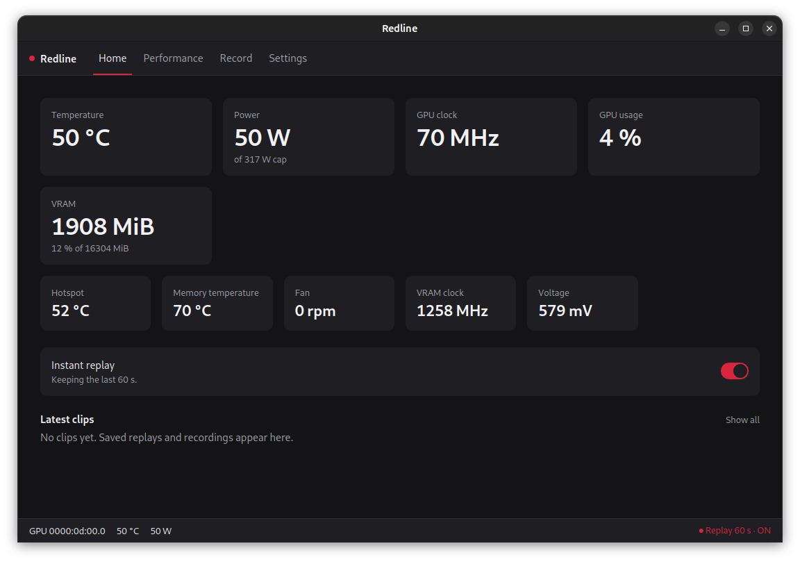
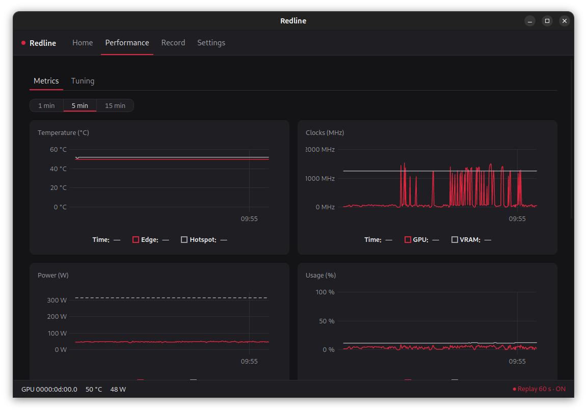

# Redline

A control panel for **AMD GPUs on Linux**. One app to watch temperatures, clocks and power draw,
tune fans and power limits, and save a replay of the last minute of gameplay with a shortcut.
The inspiration is the software AMD ships only for Windows; Redline keeps the features people
actually use and leaves the rest out.

> Independent project, not affiliated with or endorsed by AMD.





## Status

Everything listed below works in the current release. Download it from
[GitHub Releases](https://github.com/FabioSM46/redline/releases); the
[changelog](CHANGELOG.md) says what each version added and the [roadmap](docs/roadmap.md) what
comes next.

## Features

| Feature | How |
|---|---|
| Live statistics and charts | read directly from sysfs (`/sys/class/drm/cardN/device`), no permissions needed |
| In-game overlay (FPS, frametime, temperatures) | [MangoHud](https://github.com/flightlessmango/MangoHud), configured by Redline |
| Tuning: fans, power limit, profiles, clocks and undervolt | the [LACT](https://github.com/ilya-zlobintsev/LACT) daemon (`lactd`) through its socket |
| Instant replay and recording, with audio on separate tracks | [GPU Screen Recorder](https://git.dec05eba.com/gpu-screen-recorder/about/) as an external process, with hardware encoding |

Redline does not rewrite these tools: it coordinates them behind a single interface. The why is in
[docs/context.md](docs/context.md), the choices in [docs/decisions.md](docs/decisions.md).

## Install

Download the package for your system from
[GitHub Releases](https://github.com/FabioSM46/redline/releases), then install it from the folder
it is in:

```bash
sudo apt install ./redline_<version>_amd64.deb            # Ubuntu, Debian, Linux Mint
sudo pacman -U ./redline-<version>-1-x86_64.pkg.tar.zst   # Arch, CachyOS
sudo dnf install ./redline-<version>-1.fc44.x86_64.rpm    # Fedora
```

Open Redline and go to **Settings →
Dependencies**: it shows whether LACT, GPU Screen Recorder, ffmpeg and MangoHud are installed and
offers to install what is missing, with one password prompt (`pkexec`). A missing tool only
disables its feature, and the app says what to do.

**What a package sets up**: the `redline` program, the menu entry
`/usr/share/applications/com.fabiosm46.redline.desktop`, and the helper and polkit action behind
the guided install.

**What it does not**: it installs none of the four tools by itself, enables nothing at login
(starting with the system is off until you turn it on in Settings → General; the entry is then
`~/.config/autostart/com.fabiosm46.redline.desktop`), changes no kernel parameter, and adds no
package repository, so a new version is a new `.deb` installed the same way. The package is not
signed.

### Supported systems

| System | State |
|---|---|
| Ubuntu 24.04 and 26.04, Debian 13 | Supported: package and guided install of all four tools |
| Other releases based on Ubuntu 24.04 (Linux Mint, Pop!_OS, ...) | The guided install takes the Ubuntu 24.04 LACT package. The package and LACT were installed in a Linux Mint 22.3 container; not tried on a desktop |
| Arch and derivatives (CachyOS, ...) | Package and guided install of all four tools; LACT comes from the distribution |
| Fedora 44 | Package and guided install of all four tools |
| Windows, macOS | Not supported: Redline is Linux only |

**Redline itself is not available as a Flatpak**: the sandbox gets in the way of sysfs and of the
`lactd` socket. GPU Screen Recorder is a separate program: its guided install takes the Flatpak
from Flathub, and first installs Flatpak and adds the Flathub remote if they are missing.

### Requirements

- x86-64 Linux with an AMD GPU on the `amdgpu` driver (every recent Radeon)
- Wayland or X11
- For tuning: LACT with the `lactd` daemon running (verified with 0.10.1, the version the guided
  install takes; another version works with a warning)
- For replay and recording: GPU Screen Recorder (verified with 6.1.6; another version works
  with a warning)
- For previews of saved clips: ffmpeg
- For the in-game overlay: MangoHud

From a source checkout, `scripts/install-deps.sh` runs the same helper as the guided install:
LACT (the official package of the pinned version above), GPU
Screen Recorder (from Flathub), and ffmpeg and MangoHud (apt, dnf or pacman). LACT is the official
package on Ubuntu, Debian and Fedora, and the distribution's on Arch and its derivatives:

```bash
sudo bash scripts/install-deps.sh
```

### Overdrive

The fan curve on RDNA3/4 GPUs needs overdrive, the `0x4000` bit of the `amdgpu.ppfeaturemask`
kernel parameter. In **Performance → Tuning → Overdrive** Redline shows what LACT will change (it
sets the parameter for the next boot and updates the boot files) and asks it to go ahead only
after you confirm. The same switch turns it off, and refuses while a fan curve, a firmware fan
setting or a stored clock value still needs it, on any GPU and including the active profile: each
one has a **Back to default** action that you keep or revert. Redline never edits those files
itself and never reboots: the change takes effect after you reboot.

### Overlay

The overlay is MangoHud, and **Performance → Metrics → Overlay** chooses what it shows. It appears
only in the games you start with MangoHud. In Steam, paste `mangohud %command%` into the game's
Launch options (the page has a Copy button). In Lutris, open the game's Configure → System options
and turn on **FPS counter (MangoHud)**, or enter `mangohud`, without `%command%`, as the Command
prefix, under Advanced; under Wine the overlay is reliable only on Vulkan, which normally means
DXVK. A `MangoHud.conf` of your own stays untouched until you agree, in the same page, to let
Redline manage it.

## Stack

- **Backend**: Rust (edition 2024), [Tauri 2](https://tauri.app)
- **Frontend**: React 19 + TypeScript, Vite, pnpm
- **System logic**: the `redline-core` crate, with no dependency on Tauri

## Repository layout

```
redline/
├── src/                    # React + TypeScript frontend
├── src-tauri/              # Rust workspace
│   ├── src/                # Tauri app: commands exposed to the frontend
│   ├── crates/
│   │   ├── redline-core/   # sensors, lactd client, GPU Screen Recorder control
│   │   └── redline-probe/  # CLI to try redline-core pieces without the UI
│   └── tauri.conf.json
├── docs/
│   ├── context.md          # why it exists, what it takes and what it leaves out
│   ├── decisions.md        # decision log
│   ├── architecture.md     # modules and flows
│   ├── roadmap.md          # milestones
│   └── release.md          # release checklist
├── packaging/              # Arch and Fedora package definitions
├── scripts/                # install-deps.sh, pipeline helpers and automation tests
├── .github/                # CI, DeepSeek review, labeler, issue templates
├── .claude/skills/         # agent skills (/dev-issue, /process-pr, /develop-iteration, /scrum-master)
├── AGENTS.md               # rules for AI agents and the pipeline
├── CHANGELOG.md            # what each release contains
└── package.json
```

## Development

### Toolchain

| Tool | Version | Used for |
| ----- | ------------------------------- | ------------------ |
| Rust  | pinned in `src-tauri/rust-toolchain.toml` (rustfmt + clippy) | backend |
| Node  | 22.18 or later                  | frontend |
| pnpm  | 10                              | frontend |
| gh    | 2.18.0 or later                 | pipeline scripts |
| jq    | any recent                      | pipeline scripts, `scripts/test/` |
| python3 | 3.12 recommended              | DeepSeek reviewer tests |

System libraries for Tauri, on Ubuntu/Debian:

```bash
sudo apt install libwebkit2gtk-4.1-dev build-essential curl wget file \
  libayatana-appindicator3-dev libxdo-dev libssl-dev librsvg2-dev
```

### Commands

```bash
pnpm install          # frontend dependencies
pnpm tauri dev        # run the app in development with hot reload
pnpm tauri build      # release build and .deb package
```

The `.deb` ends up in `src-tauri/target/release/bundle/deb/`. A plain `pnpm tauri build` still
produces `redline.desktop`: run `bash scripts/deb-desktop-id.sh` afterwards, as the release does.
It renames the file inside the package to the bundle identifier,
`com.fabiosm46.redline.desktop`, which Tauri's bundler cannot do by itself.

Quick checks:

```bash
pnpm build                                        # frontend type-check and build
pnpm test                                         # frontend tests (node --test)
cargo test --manifest-path src-tauri/Cargo.toml   # Rust workspace tests
```

### Trying the pieces without the UI

`redline-probe` uses `redline-core` directly, from the `src-tauri/` directory:

```bash
cargo run -p redline-probe -- gpus               # AMD GPUs with their id and name
cargo run -p redline-probe -- sensors --watch     # sensors, one line per second (--gpu <id>)
cargo run -p redline-probe -- lact stats          # statistics from lactd (also: system, devices, info, config, profiles)
cargo run -p redline-probe -- audio               # audio sources for GPU Screen Recorder
# 60 s replay, game audio and microphone on two separate tracks
cargo run -p redline-probe -- replay --track default_output --track default_input
cargo run -p redline-probe -- tracks <file>.mkv   # tracks of a saved file
```

In the replay: `s` + Enter saves the last seconds, `r` + Enter starts or stops a recording,
`q` + Enter quits. Files go to `~/Videos/Redline/`. The replay needs an interactive terminal:
when stdin closes, the probe stops the recorder and exits.

### Workflow

The integration branch is `develop` (the default branch); `main` only receives releases. Work
goes issue → PR to `develop` → CI and automated DeepSeek review → merge. The rules for AI agents
and the pipeline details are in [AGENTS.md](AGENTS.md).

## Known limits

- **Global shortcuts under Wayland** go through the GlobalShortcuts portal, which GNOME
  implements from version 48. Where it exists Redline registers its shortcuts through it; on
  older versions Redline relies on the desktop's custom shortcuts.
- **Screen capture under Wayland**: the first time, the desktop asks which screen to share;
  the choice is remembered afterwards.
- **Tuning**: every change must be confirmed, otherwise LACT reverts to the previous values
  after a few seconds. That is a safeguard, not a bug.

## Release

A `v<version>` tag on a commit of `main` starts `.github/workflows/release.yml`, which builds
the `.deb`, Arch and Fedora packages and attaches them to a draft GitHub release. The release is published by hand after
checking it, following [docs/release.md](docs/release.md). The package carries `THIRD-PARTY-LICENSES` with the licenses of the crates and npm
packages compiled into the app, in `/usr/share/doc/redline/` next to `copyright`.

## Documentation

- [Context](docs/context.md)
- [Decisions](docs/decisions.md)
- [Architecture](docs/architecture.md)
- [Roadmap](docs/roadmap.md)
- [Release checklist](docs/release.md)
- [Changelog](CHANGELOG.md)

## License

[MIT](LICENSE). LACT, GPU Screen Recorder and MangoHud are separate projects with their own
licenses; GPU Screen Recorder (GPL-3.0) is only started as an external program, and none of its
code is part of Redline.
